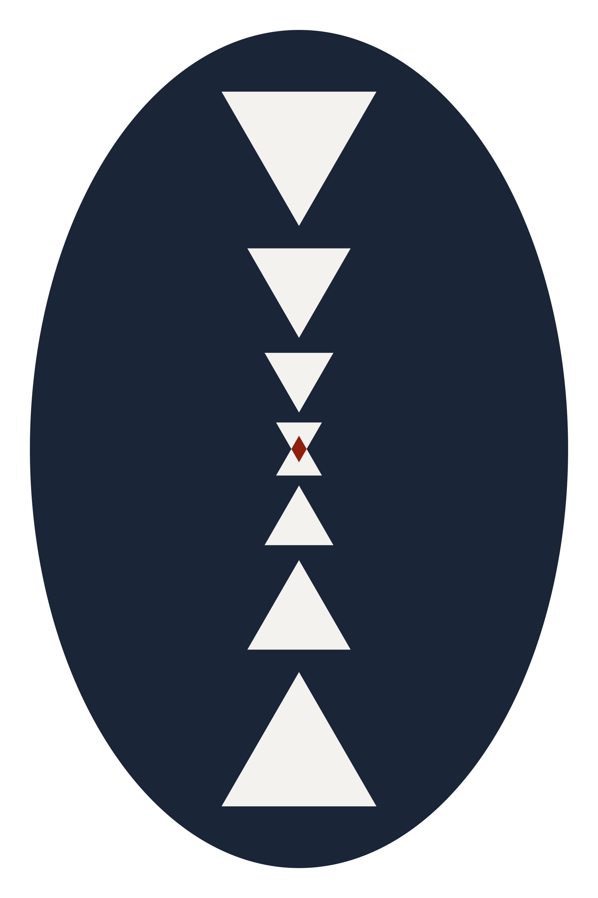

# KIPG_Charts
Constellation and beyond

## HE mark: the reversed ladder

### What was asked

> Find `HE_Geometric_C_Ledger_A_Roofline_Stairs` and change the rotation of the
> ladder: the smallest triangle in the middle, facing the smallest triangle of
> the lower part, the two meeting in the middle, the ladder growing as it
> reaches the edges of the oval. Render a PSD that opens in Pixelmator Pro at
> the highest pixel level.

### What happened to the original file

It could not be opened. It is not in this repository, and the session that
built this had no access to the computer it lives on. So the figure here is
**rebuilt from the wording of the request**, in the HE palette. It is not the
original file with one part moved. `out/..._understanding.png` draws the
assumption as a before and after so it can be confirmed or corrected at a
glance, and `out/..._options.png` shows three other readings of the same
sentence.

When the original (or even a screenshot of it) is available, the same rule
below can be applied to its exact shapes.

### The figure



An oval. On its vertical axis, two ladders of four equilateral triangles.
The smallest triangle of each ladder is in the middle and points at the other.
Their tips cross at the exact centre, and the overlap is the one red element.
Each rung out from the centre is larger, and the corners of the largest pair
sit on a line that runs parallel to the oval's edge, one tenth inside it.

The 60° apex is the brand's own angle: the lattice mark is built on a 60°
family of bars with 30° tips.

### The rule behind it

A ladder is **one triangle repeated by one operation**: scale by 3/2 about a
single fixed point on the axis. Sizes, positions and gaps are therefore all the
same sequence, and nothing is placed by eye.

Reversing the ladder is that operation read backwards. A ladder that shrinks
toward the edge has ratio 2/3. One that grows toward the edge has ratio 3/2.
Nothing else changes.

The fixed point of each ladder lies past the centre, inside the other ladder.
That is why the two smallest triangles intersect: each ladder converges on a
point that belongs to the other.

Two thirds appears three times, by construction:

| Where | What is two thirds |
| --- | --- |
| Between rungs | each rung is 2/3 the size of the next one out |
| At the centre | 2/3 of each smallest triangle's height stays on its own side |
| The crossing | the red lozenge is 2/3 as tall as that triangle |

Fitting the ladder to the oval is one equation with one unknown, the height of
the smallest triangle. It is solved directly in `he_mark/design.py`; there is
no search.

### The files

Everything is in `out/`. The long name is shortened to `…` here.

| File | What it is | Use it when |
| --- | --- | --- |
| `…_16380px.psd.zip` | Layered PSD, 10,920 × 16,380 px, 300 ppi | Start here. This is the largest size that fits in one GPU texture on a Mac. |
| `…_30000px.psd.zip` | Layered PSD, 20,000 × 30,000 px (600 megapixels) | You want the PSD format's hard ceiling of 30,000 px. Heavy to open. |
| `….svg` | Vector master, same shapes | You want any size at all. Pixelmator Pro opens it as editable shape layers. |
| `…_preview.png` | Transparent 2,000 × 3,000 preview | Quick look, mock-ups. |
| `…_understanding.png` | Before and after | Confirming the reading of the request. |
| `…_options.png` | Readings A to D | Choosing a different reading. |
| `…_construction.json` | Every construction number | Checking or reusing the geometry. |
| `…_verification.json` | The check results for each PSD | Seeing exactly what was tested. |

The PSDs are zipped because flat colour compresses about thirty to one
(73 MB becomes 2.4 MB). Double-click a zip on the Mac to get the `.psd`.

Layers, top to bottom, as they appear in the editor:

```
Crossing            red lozenge where the two smallest triangles overlap
Upper ladder        folder: Upper rung 1 (smallest) … Upper rung 4 (largest)
Lower ladder        folder: Lower rung 1 (smallest) … Lower rung 4 (largest)
Oval                navy ground
```

Every layer is one flat colour with its shape in the transparency, so any
element can be recoloured, hidden or moved on its own. Each ladder is a folder,
so a whole ladder can be turned or flipped as one object.

Colours: navy `#1B2538`, bone `#F3F2EE`, red `#911D0F`.

### Opening it in Pixelmator Pro

1. Unzip, then drag the `.psd` onto Pixelmator Pro (or File › Open).
2. The Layers sidebar should list Crossing, the two ladder folders and Oval.
3. Save as a Pixelmator Pro document if you want to keep editing.

If the 30,000 px file is slow or refuses to open, use the 16,380 px file, or
open the SVG and export at the size you need.

### What was checked, and what was not

Checked here, on both PSDs (`verify.py`, results in `out/…_verification.json`):

- The file is parsed and its data decoded by psd-tools, a reader that shares no
  code with the writer. ImageMagick and Pillow read it as well.
- Header, 300 ppi, sRGB profile, thumbnail, layer names, order and folders.
- Every layer is one flat colour, the specified one.
- Every layer's shape matches a fresh low-resolution render of the design to
  within 0.3 of one level in 255.
- The layers, recomposited at full resolution, equal the stored flattened
  picture on every pixel: 600,000,000 pixels compared, largest difference 0.
- The picture is mirror-symmetric left to right and top to bottom.

**Not checked: Pixelmator Pro itself.** It runs only on Apple hardware and this
was built on Linux. The file follows the layout Photoshop writes and passes
three independent readers, but the first real opening will be yours. Pixelmator
publishes no maximum image size; the 16,380 px file is the cautious choice and
the 30,000 px file is the format's limit rather than a tested size.

### Two things the work taught

**Exactness came from weighting, not from more samples.** The first rasteriser
averaged 16 thin slices per pixel row and was off by one level in 255 along the
flat base of one triangle. Taking more slices would only have shrunk the error.
Weighting each slice by how much of it the edge actually spans removed it: a
flat edge is now exact with a single slice per row.

**The right test was the stricter one.** A coarse comparison flagged four
pixels in the 30,000 px file. The file was right and the test was wrong: at the
two side corners of the crossing, three partly covered layers share one coarse
pixel, and a coarse composite is less accurate there than the big file.
Recompositing the decoded layers at full size is both stricter and correct.

### Rebuilding

```
pip install pillow numpy psd-tools
python3 selftest.py                       # rasteriser, PackBits, PSD round trip
python3 build.py --px 16380 30000         # SVG, previews, both PSDs into out/
python3 build.py --variant B --px 16380   # another reading: B, C or D
python3 verify.py out/*_16380px.psd       # the checks listed above
python3 sheets.py                         # the two picture sheets
```

| Module | Job |
| --- | --- |
| `he_mark/design.py` | The figure as a `Spec` and the closed-form fit |
| `he_mark/raster.py` | Coverage rasteriser, exact for straight edges |
| `he_mark/render.py` | Renders in bands across all cores; memory stays flat at any size |
| `he_mark/psd_writer.py` | Streaming PSD writer: layers, folders, profile, thumbnail, flattened picture |
| `he_mark/svg.py` | The same contours as SVG |
